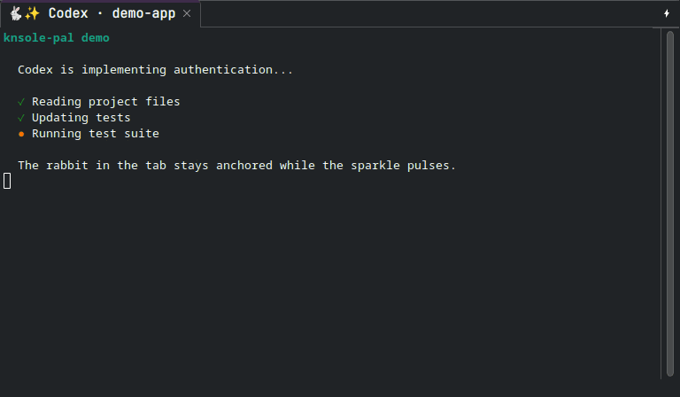
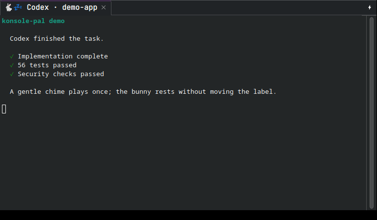
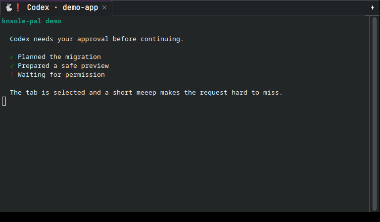
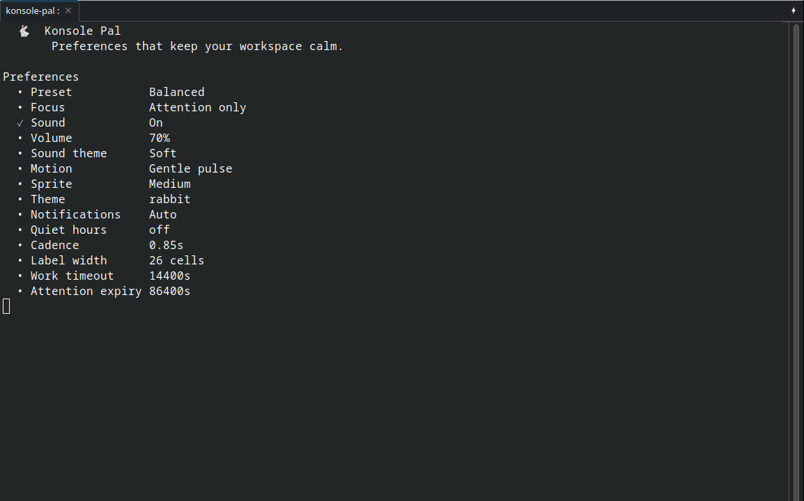

# konsole-pal 🐰

[](https://github.com/daredoole/konsole-pal/actions/workflows/ci.yml)
[](https://pypi.org/project/konsole-pal/)
[](https://pypi.org/project/konsole-pal/)
[](https://github.com/daredoole/konsole-pal/blob/main/LICENSE)

A tiny, local-first attention router for terminal AI agents. It shows when an
agent is working, keeps genuine questions in one unread inbox, and returns you
to the right tab without scraping terminal output.

<p align="center">
  
</p>

The rabbit stays in one fixed position. Only the equal-width activity symbol
changes, so the tab label never shifts and the tab never grows or shrinks.

The CLI follows the same idea: one memorable rabbit, calm typography, useful
empty states, and no decorative work when output is piped or requested as JSON.

## What you get

- **Working:** `🐇✨` / `🐇⭐` — a gentle fixed-width pulse.
- **Completed:** `🐇💤` — a resting bunny plus a soft ascending chime.
- **Needs you:** `🐇❗` — tab handoff plus a short “meeep.”
- **Failed:** `🐇💥` — a visible error state and attention sound.
- A durable attention inbox with deterministic `next` and `ack` commands.
- One sleeping animator for every tab, not one process per tab.
- Codex, Cursor, Claude Code, Gemini CLI, OpenCode, Copilot CLI, and Aider adapters.
- Native Konsole, Zellij, tmux, Kitty, WezTerm, Ghostty, SSH, and generic support.
- Validated rabbit, ASCII, monochrome, and local data-only theme packs.
- Safe hook installation that merges existing configuration and creates backups.
- No network access, telemetry, prompt storage, or transcript storage.

## Real state previews

These screenshots were captured from a real Konsole 26.04 session on an isolated
display containing only the controlled demo. They contain no username, hostname,
filesystem path, notifications, or device information.

<p align="center">
  
  
</p>

## A CLI designed for humans and scripts

<p align="center">
  
</p>

Interactive commands use a terminal-native palette and aligned status rows.
`NO_COLOR` disables color, non-TTY output contains no escape sequences, and
`--json` is available for status, inbox, emit, setup, doctor, settings, themes,
and hook health.

## Install in three commands

Python 3.10 or newer is required. [pipx](https://pipx.pypa.io/) is recommended
because it installs the CLI in an isolated environment.

```sh
pipx install konsole-pal
konsole-pal setup
konsole-pal demo
```

Setup connects the supported agents detected on your machine. Restart those
agents after installation. That is it.

Prefer `uv`?

```sh
uv tool install konsole-pal
konsole-pal setup
```

For native Konsole control, install whichever Qt D-Bus command your distribution
provides: `qdbus6`, `qdbus-qt6`, or `qdbus`. Without it, konsole-pal safely
falls back to the standard terminal-title escape sequence.

For sound, it automatically uses the first available player: PipeWire
(`pw-play`), PulseAudio (`paplay`), or ALSA (`aplay`).

## Agent setup

The installer preserves unrelated hooks, writes mode-0600 files, and makes a
`hooks.json.bak` before changing an existing file.

```sh
# Guided setup for detected agents
konsole-pal setup

# Calm defaults without prompts (useful for dotfiles)
konsole-pal setup --yes

# Or one agent
konsole-pal setup codex
konsole-pal setup cursor
konsole-pal setup claude gemini opencode copilot aider

# Confirm the active configuration
konsole-pal hooks status
```

Every adapter normalizes its native lifecycle into the same four events:

| Native event class | Konsole Pal state |
| --- | --- |
| prompt submitted / agent starts | Working |
| permission, approval, question | Needs you |
| agent stop / idle / after-agent | Completed |
| stop failure / session error | Failed |

Hook installers preserve unrelated configuration and create private backups.
Aider uses its official notification command; OpenCode gets a data-minimizing
local plugin. `konsole-pal emit STATE --agent NAME` integrates any other tool.

## Attention inbox

Completion is display state; attention is durable unread state; focus is a
short-lived event. Keeping them separate prevents an old completion from ever
stealing focus after an animator restart.

```sh
konsole-pal inbox          # only unread questions, approvals, and failures
konsole-pal next           # jump to and acknowledge the newest focusable item
konsole-pal ack codex      # clear one matching item
konsole-pal ack --all
konsole-pal watch          # optional on-demand view; no permanent dashboard
```

`next` acknowledges only after the terminal confirms that it focused the target.
An unsupported remote target stays unread instead of silently disappearing.

## Terminal support

| Environment | Status display | Attention handoff |
| --- | --- | --- |
| Konsole | Native D-Bus tab title | Selects the originating Konsole tab |
| Zellij | Stable tab ID; pane fallback | Focuses the originating pane/tab |
| tmux | Stable window title and socket | Selects the originating window/pane |
| Kitty | OSC title + clickable OSC 99 notification | Focuses by window ID when permitted |
| WezTerm | OSC title + native notification | Activates the originating pane |
| Ghostty | OSC title + OSC 9 notification | Clickable terminal notification |
| SSH / other terminals | OSC title on the original PTY | Terminal notification or bell |

Nested multiplexers take priority over their host terminal. Remote agents never
invoke local desktop automation; they use terminal escape protocols carried by
the originating PTY.

## Settings

Settings are layered from lowest to highest priority:

1. Built-in defaults
2. User config: `~/.config/konsole-pal/config.toml`
3. Nearest project config: `.konsole-pal.toml`
4. `KONSOLE_PAL_*` environment variables
5. Command flags

```sh
konsole-pal config show
konsole-pal config set focus attention
konsole-pal config set volume 0.45
konsole-pal config set sprite_size large
konsole-pal config set theme ascii
konsole-pal config set quiet_hours 22:00-08:00
konsole-pal config set sound false --agent claude
konsole-pal config set animation static --project
konsole-pal config reset volume
```

| Setting | Values | Default |
| --- | --- | --- |
| `preset` | `minimal`, `balanced`, `playful` | `balanced` |
| `focus` | `all`, `attention`, `never` | `attention` |
| `sound` | `true`, `false` | `true` |
| `volume` | `0.0`–`1.0` | `0.7` |
| `sound_theme` | `soft`, `arcade`, `silent` | `soft` |
| `animation` | `pulse`, `static` | `pulse` |
| `animation_interval` | `0.2`–`10.0` seconds | `0.85` |
| `sprite_size` | `small`, `medium`, `large` | `medium` |
| `theme` | built-in or validated installed theme | `rabbit` |
| `notification` | `auto`, `off`, `terminal`, `desktop`, `bell` | `auto` |
| `quiet_hours` | `off` or `HH:MM-HH:MM` | `off` |
| `attention_timeout` | `0` or `60`–`2592000` seconds | `86400` |
| `label_max_cells` | `8`–`80` | `26` |
| `working_timeout` | `0` or `60`–`604800` seconds | `14400` |

`focus=attention` is a calmer setup: questions, approvals, and errors select
their tabs, while normal completions only rest and chime. `animation=static`
shows one working icon and immediately exits the animator for effectively zero
idle resource use. Sprite presets change the rabbit's fixed-width footprint;
Konsole controls the actual emoji font size for the whole tab bar.

Project policy belongs in `.konsole-pal.toml`; agent overrides use tables such
as `[agents.claude]`. The CLI writes them safely with `--agent`. Presets apply
first, so explicit settings always win.

| Sprite preset | Working | Complete | Needs you |
| --- | --- | --- | --- |
| `small` | `🐇*` / `🐇+` | `🐇z` | `🐇!` |
| `medium` | `🐇✨` / `🐇⭐` | `🐇💤` | `🐇❗` |
| `large` | `🐇✨✨` / `🐇⭐⭐` | `🐇💤💤` | `🐇❗❗` |

Preview or install a data-only JSON theme:

```sh
konsole-pal theme list
konsole-pal theme preview ascii --sprite-size large
konsole-pal theme install ./my-fixed-width-theme.json
```

Every frame and final state must occupy exactly the same number of terminal
cells. Manifests containing control characters or shifting widths are rejected.

See [examples/config.toml](https://github.com/daredoole/konsole-pal/blob/main/examples/config.toml)
for a complete file.

## Manual use

Wrap any command:

```sh
konsole-pal run --agent tests --label "Test suite" -- pytest
```

Or update the current tab directly:

```sh
konsole-pal set working --agent codex
konsole-pal set attention --agent codex --focus
konsole-pal emit working --agent my-agent
konsole-pal status
konsole-pal sound done
konsole-pal sound attention
konsole-pal completions zsh
```

Generate completions for `bash`, `zsh`, `fish`, or `powershell`. Human-readable
commands keep routing paths private unless `--verbose` is supplied.

## Maintenance and troubleshooting

```sh
konsole-pal doctor
konsole-pal doctor --repair
konsole-pal hooks status
konsole-pal reset
```

- **No bunny:** run `konsole-pal doctor --repair`, restart the agent, and submit a prompt.
- **No sound:** run `konsole-pal sound done` and install PipeWire, PulseAudio, or ALSA tools.
- **Too much tab switching:** run `konsole-pal config set focus attention`.
- **Missed request:** run `konsole-pal inbox --verbose`, then `konsole-pal next`.
- **Prefer no motion:** run `konsole-pal config set animation static`.
- **Stale title:** run `konsole-pal reset`.
- **SSH:** install konsole-pal and its hooks on the remote host as well.

`reset` stops the shared animator, restores resting titles, and removes runtime
state. It does not remove settings or agent hooks.

## Privacy and security

- Runtime files live under `$XDG_RUNTIME_DIR/konsole-pal` in a mode-0700 directory.
- State, configuration, generated sounds, hook files, and backups use mode 0600.
- State contains only a short display label and terminal routing identifiers.
- Desktop and terminal notifications contain only the generic state and that label.
- Prompts, responses, transcripts, command output, and environment dumps are never stored.
- Labels are stripped of control characters and width-limited before reaching a title.
- External programs are invoked with argument arrays and `shell=False`.
- Python 3.11+ has no runtime dependencies; Python 3.10 uses only the small
  `tomli` standard-library backport. The package performs no network requests or telemetry.

The `konsole-pal run -- ...` command intentionally executes exactly the local
command placed after `--`; it does not interpret it through a shell.

See [SECURITY.md](https://github.com/daredoole/konsole-pal/blob/main/SECURITY.md)
for reporting and
[docs/SECURITY-REVIEW.md](https://github.com/daredoole/konsole-pal/blob/main/docs/SECURITY-REVIEW.md)
for the release threat model
and audit results.

## Resource use

All tabs share one low-priority Python worker. It sleeps between 0.85-second
updates and exits after work ends. A 1.0.0 release measurement showed 0.0% CPU
while sleeping, approximately 19.6 MiB RSS for the single shared worker, and
approximately 54.8 ms average hook startup (58.2 ms p95). Results vary by system.

The polished CLI adds no runtime dependency and does not run in the background.
Static animation mode exits immediately after rendering the working title.
Sounds are synthesized once, cached privately by volume, and played asynchronously.

## Uninstall

```sh
konsole-pal reset
konsole-pal hooks uninstall
pipx uninstall konsole-pal
```

If installed with uv, replace the last command with
`uv tool uninstall konsole-pal`. Settings remain in
`~/.config/konsole-pal/config.toml` until you remove them.

## Development

```sh
git clone https://github.com/daredoole/konsole-pal.git
cd konsole-pal
uv sync --extra dev
make verify
```

`make verify` runs Ruff, all unit tests, real tmux/Zellij integration tests
when available, bytecode compilation, wheel/sdist builds, and package metadata
validation. CI repeats the suite on Python 3.10 through 3.14.

Please read [CONTRIBUTING.md](https://github.com/daredoole/konsole-pal/blob/main/CONTRIBUTING.md),
the [changelog](https://github.com/daredoole/konsole-pal/blob/main/CHANGELOG.md),
and the [MIT license](https://github.com/daredoole/konsole-pal/blob/main/LICENSE).

## Design limits

- Focus handoff selects a tab inside its existing Konsole window. It does not
  force the Konsole application above unrelated desktop windows.
- Generic terminals and SSH receive an OSC title and bell, not local GUI control.
- Kitty focus requires its opt-in remote-control capability; without it the item
  remains unread and the CLI explains why.
- Cursor's stop event does not always distinguish an answer from a question, so
  it receives the configured completion handoff.

## References

- [KDE: Scripting Konsole](https://docs.kde.org/trunk_kf6/en/konsole/konsole/scripting.html)
- [OpenAI: Codex hooks](https://developers.openai.com/codex/hooks)
- [Cursor: Agent best practices](https://cursor.com/blog/agent-best-practices)
- [Zellij: CLI recipes](https://zellij.dev/documentation/cli-recipes.html)
- [tmux manual](https://man7.org/linux/man-pages/man1/tmux.1.html)
